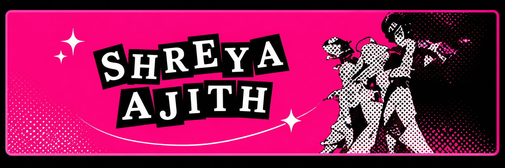
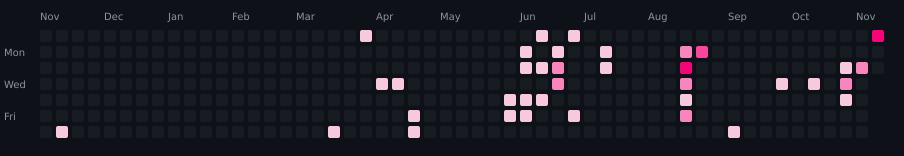

  

  
  
  

 

<h3>Who Am I?</h3>

I am a <b>Computer Science</b> student, <b>developer</b>, and <b>designer</b>, currently working as a freelancer while actively exploring the intersection of <b>technology</b>, <b>design</b>, and <b>problem-solving</b>. My journey is driven by a continuous curiosity to learn, build, and create, from web software development to crafting thoughtful and functional design experiences.

Over time, I've built experience across the web development ecosystem, with a strong passion for <b>front-end development</b>, where logic meets creativity and visual design. Alongside web technologies, I enjoy expanding my skills into mobile development and exploring modern applications using <b>Android Studio</b> and <b>React Native</b>.

At the moment, I am working as a freelancer, developing complete systems for companies in my city, from planning and interface design to implementation and delivery. This hands-on experience has strengthened my <b>problem-solving skills</b>, <b>technical versatility</b>, and ability to understand <b>business needs</b>, while constantly pushing me to grow as a developer and professional.

You can click here

  
  

<h2 align="center">My Contributions</h2>

  

<h2 align="center">Tech Stack</h2>

  

  

